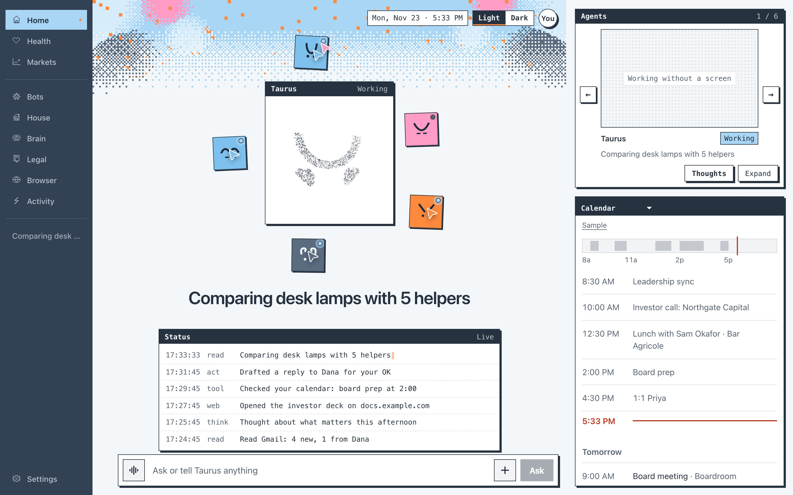
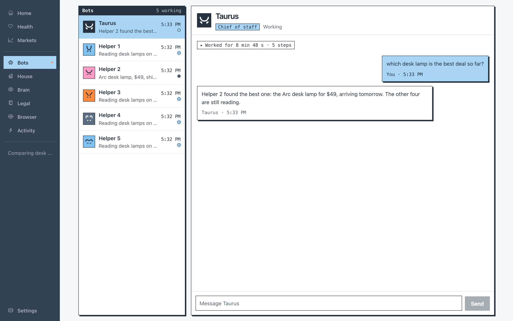
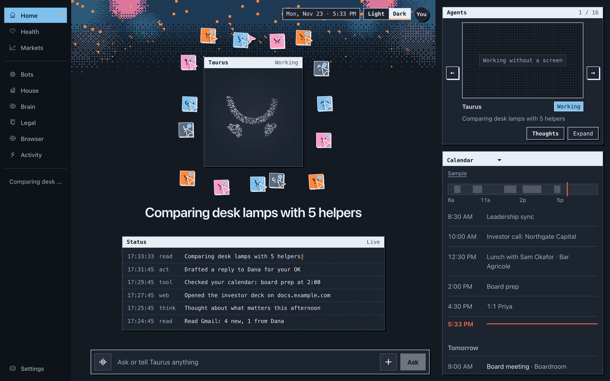
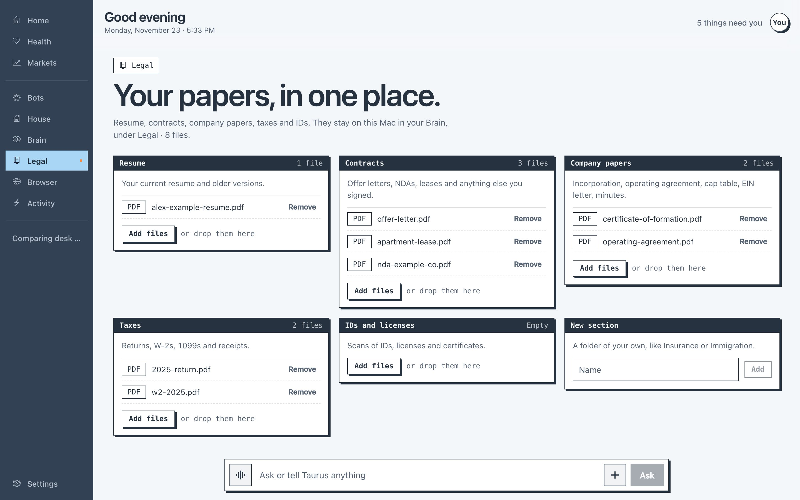
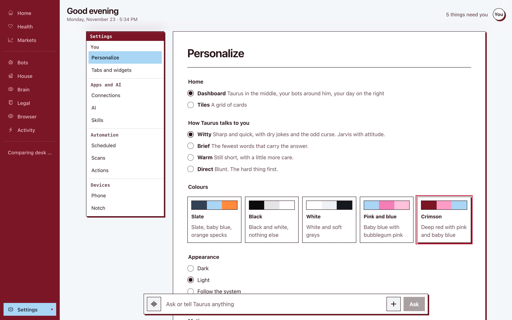
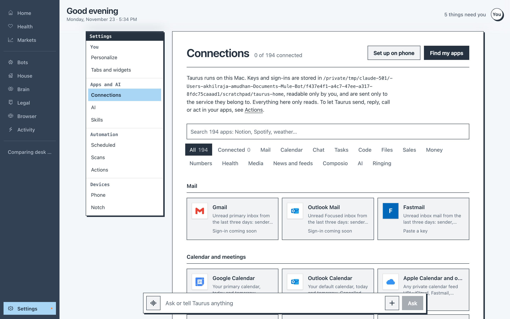
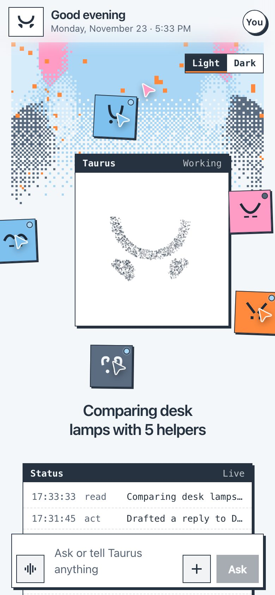

# Taurus

**A Jarvis-style assistant that lives on your Mac.** Taurus sits in the middle of one clean screen with the bots working for you around him, your day on the right, and a type bar at the bottom. Talk or type, and he reads your real mail, calendar, messages, health and numbers to answer, sends helpers out to the web in parallel, moves your windows, plays your music, and rings every screen (then calls your phone) when something truly can't wait.

Everything runs on your own computer. Your keys and sign-ins stay in `~/.taurus`, the AI you pick only sees what a question needs, and Taurus never sends, posts or buys anything until you approve that exact action.



<p align="center">
  <a href="https://github.com/ara-mkr/OXBOT/releases/latest"><b>Download for Mac</b></a>
  &nbsp;·&nbsp;
  <a href="#whats-new-in-030">What's new</a>
  &nbsp;·&nbsp;
  <a href="#run-it-from-source">Run from source</a>
  &nbsp;·&nbsp;
  <a href="#make-it-call-your-phone">Make it call your phone</a>
</p>

---

## Download

1. Open the [latest release](https://github.com/ara-mkr/OXBOT/releases/latest) and download **Taurus-0.3.2-AppleSilicon.dmg**. Taurus is built for Apple silicon Macs (M1 and later).
2. Open the DMG and drag **Taurus** into **Applications**.
3. The first time you open it, macOS says it can't check the app, because it isn't signed with a paid Apple Developer ID. Go to **System Settings → Privacy & Security**, scroll to the message about Taurus and choose **Open Anyway**. You only do this once.
4. Taurus shows up in the menu bar as the horns mark. Closing the window keeps him there so he can still ring you and work in the background. **Quit Taurus** in that menu stops him.

The first launch walks you through it out loud: your name, which apps to connect, and a quick tour. Until you connect something, every section shows clearly labelled **Sample** data.

## What's new in 0.3.0

- **A new Home.** Taurus in his own window over a dithered pixel sky, with what he's doing right now as the headline and a live status log under him. Your pick of calendar, inbox, what needs you, health, news or stocks on the right, and the chat bar at the bottom. Light or dark.
- **Bots around Taurus.** Every bot working for you, his browser and each helper of a swarm, gets a small box bubbled around his window (up to 15, smaller as more join), each with its own little Taurus (different horns and eyes) and a light that pulses while it works. Click one and the **Agents** window shows its screen and its thoughts; **Expand** opens it in the new **Bots** tab, a full chat with each bot: every step it took, what it found, and a box to ask Taurus about it.
- **Legal.** Your resume, contracts, company papers, taxes and IDs in one place, kept as notes in your Brain on this Mac so Taurus can read them when you ask. (ProFinder is gone.)
- **Colours.** Slate, Black, White, Pink and blue, or Crimson, in light and dark, with hard square windows throughout. Settings now lists its pages down the side.
- **Faster and smarter memory.** Core memory goes with every question; recall picks the few facts that fit it, from your memories, Brain notes and the words inside your files (a PDF is read once, then remembered). Other AI apps on your Mac can use Taurus's memory through an optional MCP server.
- **More from your apps.** Apple Calendar and Notion Calendar, several Gmail accounts at once, Spotify and Apple Music controls with nothing connected, and DeepSeek for everyday questions with Claude for big jobs.
- **Real voices.** The natural Kokoro voices now ship inside the app, so every voice in Personalize sounds like itself. Talk is a little level meter that dances while Taurus listens.
- **On your Mac.** Close the window and Taurus keeps working from the menu bar: a cursor comes out of the menu bar for Mac work ("move Notes to the right side of my screen"), and helpers fly in their own colours.
- **Cooler.** Home idles at about 3% CPU instead of about 30%.

## What it does

<table>
<tr>
<td width="50%"><br><b>Bots.</b> Send a swarm of helpers to compare prices or research something, and watch each one in its own chat: every page it read, what it found, and how long it worked.</td>
<td width="50%"><br><b>Up to fifteen at once.</b> The boxes shrink as more bots join, and each one's light tells you whether it's still working, done, or stopped.</td>
</tr>
<tr>
<td><br><b>Legal.</b> Drop in your resume, offer letters, leases, incorporation papers and tax forms. They stay on your Mac, and Taurus can answer "when does my lease end?" from them.</td>
<td><br><b>Make it yours.</b> Five colour sets, light or dark, how Taurus talks to you (witty, brief, warm or direct), and his voice.</td>
</tr>
<tr>
<td><br><b>194 connections.</b> Gmail, Outlook, Google and Apple Calendar, Slack, GitHub, Linear, Notion, Stripe, HubSpot, WHOOP, Oura, Strava, Spotify and many more. Reading is the default; acting needs its own switch.</td>
<td><br><b>Brain.</b> What Taurus knows about you, as plain notes on your Mac you can read, edit or delete, with a memory panel that shows exactly what each question sent.</td>
</tr>
<tr>
<td><br><b>It rings when it matters.</b> A meeting about to start or mail from a VIP takes over every open screen like an alarm. Don't answer, and it pushes to your phone, then <i>calls</i> it.</td>
<td align="center"><br><b>On your phone too.</b> Open it on your phone over Wi-Fi and add it to the home screen; it rings there as well.</td>
</tr>
</table>

Also inside: "Hey Taurus" and double-clap to start talking, Taurus in the notch and over any app, House controls for lights and scenes, scheduled tasks, scans that read new mail and messages for you, skills, and MCP servers.

## Make it call your phone

Taurus places real phone calls through [Twilio](https://www.twilio.com/try-twilio). The free trial is enough to call **you**:

1. Sign up for Twilio and choose the **Limited trial** (no card needed). Verify your own mobile number when it asks.
2. Twilio gives your trial account a phone number. Find it, with your **Account SID** and **Auth token**, on the Twilio console's home page.
3. In Taurus, open **Settings → Connections → Phone call (Twilio)** and paste the Account SID, the auth token, the Twilio number and your mobile.
4. **Settings → Phone → Call me now.** Your phone rings within a few seconds.

On the trial, each call starts with a short Twilio message before Taurus speaks, and it can only call numbers you've verified. A paid Twilio account has its own pricing and calling rules. To let Taurus call or text other people, turn on **Settings → Actions → Calls and texts**; every call still waits for your approval.

## AI

Pick whichever you have in **Settings → AI**:

- **Taurus free:** a free [OpenRouter](https://openrouter.ai) account, signed in with one click. Available models and limits depend on your OpenRouter account.
- **A plan you already pay for:** Claude, ChatGPT or Gemini, through their official apps on your Mac (Claude Code, Codex, Gemini CLI). Sign in to the app once in Terminal, then press **Test it**.
- **An API key:** Anthropic, OpenAI, or any OpenAI-compatible service, including local models.

## Run it from source

You need Node 22.18 or newer and pnpm. The source folder is `Taurus`; an `OXBOT` compatibility link keeps older local launch paths working.

```bash
cd Taurus
pnpm setup      # installs the server, web app and desktop app
pnpm desktop    # opens Taurus as a desktop app
```

Other ways to run it:

```bash
pnpm start      # one process: builds the web app, then serves it on http://localhost:8787
pnpm dev        # for working on it: server on :8787, web app with live reload on :5173
pnpm check      # typecheck, tests, lint and build for every app
```

## Privacy

- Taurus runs on your computer. There is no Taurus cloud, account, telemetry or auto-update.
- Keys and sign-ins live in `~/.taurus`, readable only by your user, and go only to the service they belong to.
- Connections read by default. Sending email, replying in Slack, calling, texting, buying or changing anything is a separate switch, and even then nothing happens until you approve that exact action: who, what, the exact words, the item and total.
- The voice runs on your Mac. Speech recognition uses your browser's built-in service, or Moonshine on your Mac in the desktop app.

## Project layout

| Path | What |
|---|---|
| `apps/server` | Node server: connectors, dashboard, Ask, actions, ringing, voice |
| `apps/web` | React app: Home (the Deck), Bots, Brain, Legal, House, Settings |
| `apps/desktop` | Electron app: menu bar, notch, Taurus over any app, packaging |
| `apps/broker` | The one-click sign-in service for Google, Microsoft and others |
| `apps/site` | The product website |

## License

No license has been chosen yet, so this is not yet open source. The notch is adapted from GPL-3.0 code, so a public release will be GPL-3.0.
