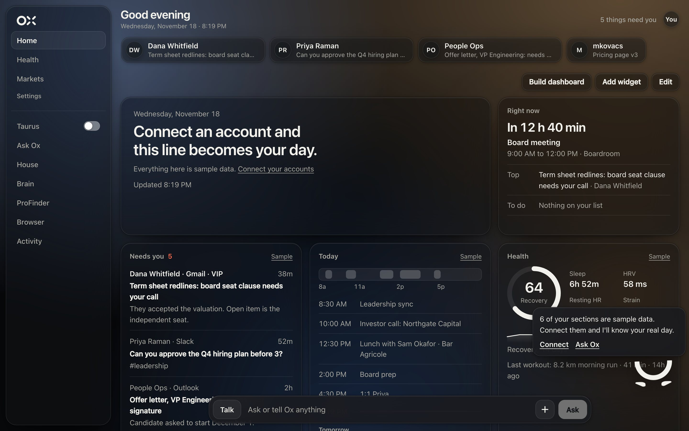
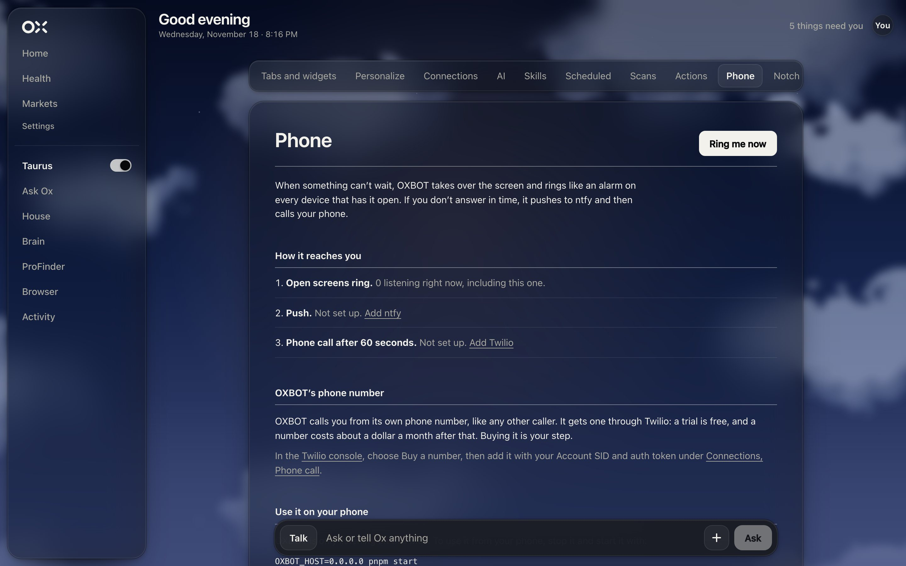
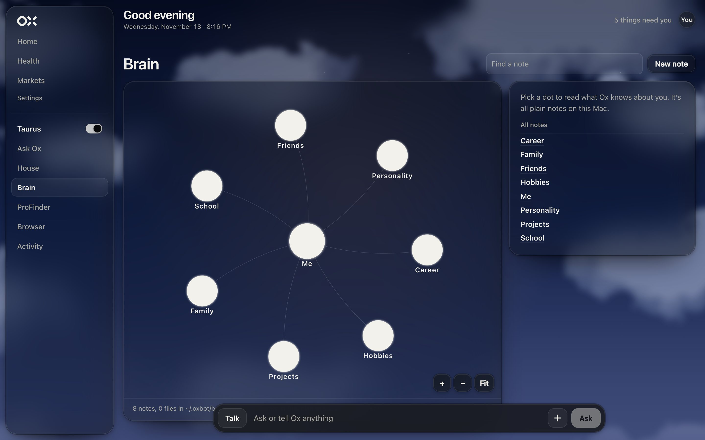
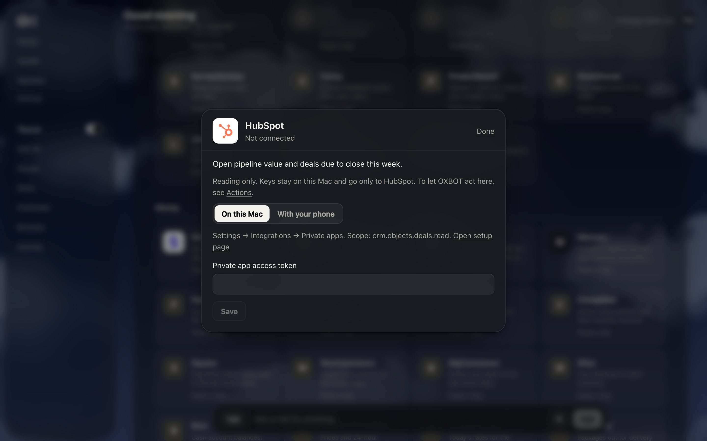
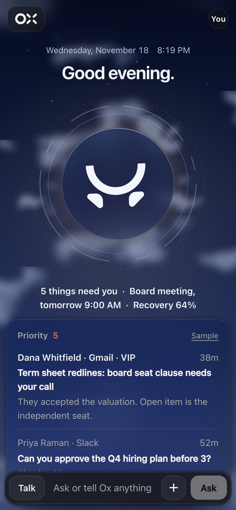

# Taurus

**Your local Jarvis-style assistant.** Keep the particle-orb HUD open, or close it and let Taurus work from the Mac menu bar. Coloured cursors show browser helpers working in parallel; one cursor accompanies native Mac actions. One screen with what needs you, your day, your body and your numbers, pulled live from the apps you already use. Ask it anything by typing or talking. When something truly can't wait, it rings every screen like an alarm, then calls your phone.

The app and server run on your own computer; configured AI providers receive your questions and relevant context. Your keys and sign-ins stay in `~/.taurus`, and Taurus never sends, posts or buys anything until you approve that exact action.


<p align="center">
  <a href="https://github.com/ara-mkr/OXBOT/releases/latest"><b>Download for Mac</b></a>
  &nbsp;·&nbsp;
  <a href="#run-it-from-source">Run from source</a>
  &nbsp;·&nbsp;
  <a href="#make-it-call-your-phone">Make it call your phone</a>
</p>

---

## Download

1. Open the [latest release](https://github.com/ara-mkr/OXBOT/releases/latest) and check the release name before installing. New local builds are named **Taurus**; older downloads may still carry the previous product name.
2. Open the DMG and drag **Taurus** into **Applications**.
3. The first time you open it, macOS says it can't check the app, because it isn't signed with a paid Apple Developer ID. Go to **System Settings → Privacy & Security**, scroll to the message about Taurus and choose **Open Anyway**. You only do this once.
4. Taurus shows up in the menu bar as the horns mark. Closing the window keeps it there so it can still ring you. **Quit Taurus** in that menu stops it.

The first launch walks you through it out loud: your name, which apps to connect, and a quick tour. Until you connect something, every section shows clearly labelled **Sample** data.

> Windows and Linux builds come out of the same code (`pnpm desktop:build`); see [the install notes](Taurus/docs/13-desktop-and-install.md).

## What it does

<table>
<tr>
<td width="50%"><br><b>Your day on one board.</b> Mail, chat, calendar, tasks, health and markets, live from the apps you connect. Rearrange it, add widgets, or just tell it "build me a board for investor week".</td>
<td width="50%"><br><b>Ask Taurus.</b> Type, talk, attach a file or share your screen. Taurus reads your real data while it answers ("what's my recovery today?") and drafts the reply, the calendar entry or the order for you to approve.</td>
</tr>
<tr>
<td><br><b>It rings when it matters.</b> A meeting about to start or mail from a VIP takes over every open screen like an alarm. Don't answer, and it pushes to your phone, then <i>calls</i> it.</td>
<td><br><b>Brain.</b> What Taurus knows about you, as plain notes on your Mac you can read, edit or delete. It learns only what you tell it to remember.</td>
</tr>
<tr>
<td><br><b>194 connections.</b> Gmail, Outlook, Google and Apple Calendar, Slack, GitHub, Linear, Notion, Stripe, HubSpot, WHOOP, Oura, Strava, Spotify and many more. Reading is the default; acting needs its own switch.</td>
<td><br><b>House.</b> Lights, blinds and scenes through Home Assistant, Hue, LIFX and Apple Home. "Movie time" or "goodnight" from anywhere. Locks and garage doors always ask first.</td>
</tr>
<tr>
<td><br><b>Connecting is one sheet.</b> Sign in, or paste a key from the app's own settings. Keys stay on this Mac and go only to the service they belong to.</td>
<td align="center"><br><b>On your phone too.</b> Open it on your phone over Wi-Fi and add it to the home screen; it rings there as well.</td>
</tr>
</table>

Also inside: a voice that runs entirely on your Mac (Kokoro, no account needed), "Hey Taurus" and double-clap to start talking, Taurus in the notch and over any app, scheduled tasks, scans that read new mail and messages for you, skills, MCP servers, and a swarm of helpers for research and price comparisons.

## Make it call your phone

Taurus places real phone calls through [Twilio](https://www.twilio.com/try-twilio). The free trial is enough to call **you**:

1. Sign up for Twilio and choose the **Limited trial** (no card needed). Verify your own mobile number when it asks.
2. Twilio gives your trial account a phone number. Find it, with your **Account SID** and **Auth token**, on the Twilio console's home page.
3. In Taurus, open **Settings → Connections → Phone call (Twilio)** and paste the Account SID, the auth token, the Twilio number and your mobile.
4. **Settings → Phone → Call me now.** Your phone rings within a few seconds.

On the trial, each call starts with a short Twilio message before Taurus speaks, and it can only call numbers you've verified. A paid Twilio account has its own pricing and calling rules. To let Taurus call or text other people, turn on **Settings → Actions → Calls and texts**; every call still waits for your approval.

## AI

Pick whichever you have in **Settings → AI**:

- **Taurus free:** a free [OpenRouter](https://openrouter.ai) account, signed in with one click. Available models and limits depend on your OpenRouter account.
- **A plan you already pay for:** Claude, ChatGPT or Gemini, through their official apps on your Mac (Claude Code, Codex, Gemini CLI). Sign in to the app once in Terminal, then press **Test it**.
- **An API key:** Anthropic, OpenAI, or any OpenAI-compatible service, including local models.

## Run it from source

You need Node 22.18 or newer and pnpm. The source folder is `Taurus`; an `OXBOT` compatibility link keeps older local launch paths working.

```bash
cd Taurus
pnpm setup      # installs the server, web app and desktop app
pnpm desktop    # opens Taurus as a desktop app
```

Other ways to run it:

```bash
pnpm start      # one process: builds the web app, then serves it on http://localhost:8787
pnpm dev        # for working on it: server on :8787, web app with live reload on :5173
pnpm check      # typecheck, tests, lint and build for every app
```

Developer notes: [`Taurus/README.md`](Taurus/README.md). Design and decisions: [`Taurus/docs`](Taurus/docs).

## Privacy

- Taurus runs on your computer. There is no Taurus cloud, account, telemetry or auto-update.
- Keys and sign-ins live in `~/.taurus`, readable only by your user, and go only to the service they belong to.
- Connections read by default. Sending email, replying in Slack, calling, texting, buying or changing anything is a separate switch, and even then nothing happens until you approve that exact action: who, what, the exact words, the item and total.
- The voice runs on your Mac. Speech recognition uses your browser's built-in service, or Moonshine on your Mac in the desktop app.

## Project layout

| Path | What |
|---|---|
| `Taurus/apps/server` | Node server: connectors, dashboard, Ask, actions, ringing, voice |
| `Taurus/apps/web` | React app: Home, Taurus, Ask, Brain, House, Settings |
| `Taurus/apps/desktop` | Electron app: menu bar, notch, Taurus over any app, packaging |
| `Taurus/apps/broker` | The one-click sign-in service for Google, Microsoft and others |
| `Taurus/apps/site` | The product website |
| `Taurus/docs` | Plans, design rules and the decision log |

## License

No license has been chosen yet ([`Taurus/LICENSE-DECISION.md`](Taurus/LICENSE-DECISION.md)), so this is not yet open source. The notch is adapted from GPL-3.0 code, so a public release will be GPL-3.0.
